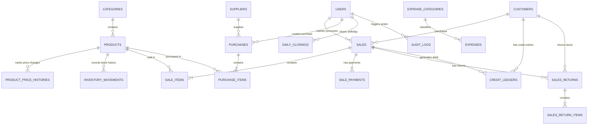

# Al-Noor Mart - Entity Relationship Diagram (ERD)

## Detailed Field Mapping

### Users
- `id` (PK)
- `name`, `email`, `password`, `role`, `status`

### Categories
- `id` (PK)
- `name`, `description`, `status`, `created_by`

### Products
- `id` (PK)
- `category_id` (FK)
- `name`, `sku`, `barcode`, `selling_mode`, `stock_unit`, `base_unit`, `base_price`, `purchase_price`, `minimum_stock`, `current_stock`, `status`

### Sales & Sale Items
- `sales`: `id` (PK), `invoice_number`, `idempotency_key`, `customer_id`, `subtotal`, `discount`, `tax`, `total`, `paid_amount`, `due_amount`, `payment_status`, `sale_status`, `cashier_id`
- `sale_items`: `id` (PK), `sale_id` (FK), `product_id` (FK), `product_name_snapshot`, `selling_mode`, `unit_base_price_snapshot`, `quantity`, `weight_grams`, `subtotal`, `discount`, `total`

### Inventory Movements
- `id` (PK)
- `product_id` (FK)
- `movement_type` (opening_stock, purchase, sale, sale_return, purchase_return, adjustment)
- `quantity_or_grams` (delta)
- `stock_before`, `stock_after`, `reference_type`, `reference_id`, `user_id`

### Credit Ledgers
- `id` (PK)
- `customer_id` (FK), `sale_id` (FK, nullable), `transaction_type`, `amount`, `balance_after`, `reference_number`, `notes`, `created_by`

### Daily Closings
- `id` (PK)
- `closing_date` (UNIQUE), `opening_cash`, `total_sales_amount`, `cash_sales_amount`, `credit_sales_amount`, `other_sales_amount`, `total_customer_payments`, `total_expenses`, `total_refunds`, `expected_cash`, `actual_cash`, `difference`, `closed_by`, `is_reopened`
